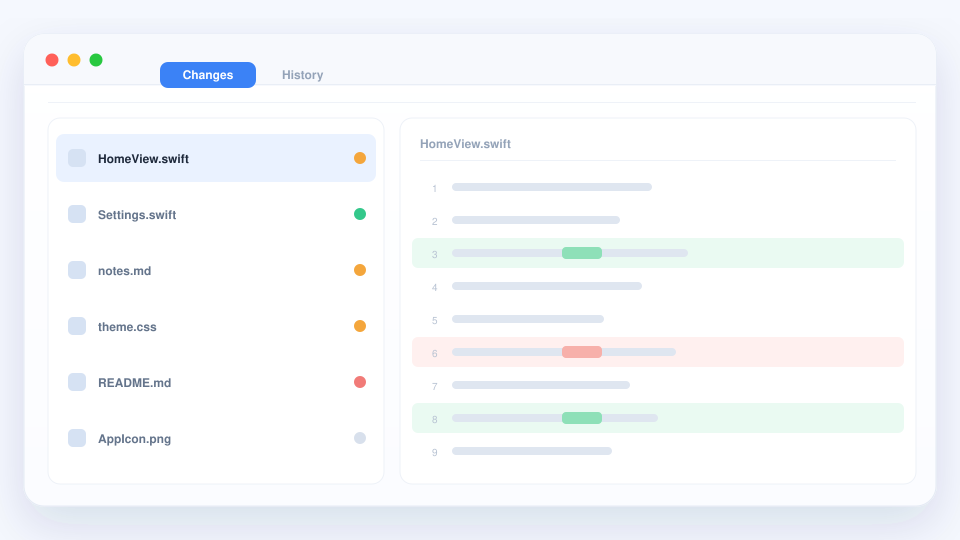

# Vor dem Commit

Ein kurzes „Was habe ich eigentlich geändert?“ ist vor jedem Commit sinnvoll.
Öffnen Sie einen Projektordner in qDiff, und die Antwort liegt bereits bereit.

## Einen Projektordner öffnen

Wählen Sie den Ordner eines Git-Projekts über **Ablage → Öffnen** aus oder
ziehen Sie ihn ins Fenster. qDiff fasst die Dateien, die Sie bearbeitet haben,
in einer Liste zusammen.

## Erst die Liste, dann die Änderungen

Jede Datei ist danach gekennzeichnet, was mit ihr geschehen ist: neu, geändert
oder entfernt. Klicken Sie eine an, und rechts sehen Sie genau, was sich darin
geändert hat — mit denselben Farben und Hervorhebungen auf Wortebene wie bei
einem normalen Dateivergleich.

Arbeiten Sie sie eine nach der anderen durch — die Liste merkt sich Ihre
Position, sodass bei einer langen Prüfung nichts übersprungen wird.

## Im selben Fenster abschließen

Wenn alles stimmt, führen Sie den Commit von hier aus. Sie können auch
aktualisieren, pushen, zurücksetzen oder einen Konflikt lösen, ohne den
Vergleich zu verlassen. Es muss keine andere App geöffnet sein, und ein Konto
ist nicht erforderlich.

::: tip Kein Projektordner?
Jeder gewöhnliche Ordner öffnet sich weiterhin als normaler Ordnervergleich —
[Ordner vergleichen](./folders.md) funktioniert überall.
:::

Weiter: [Bilder, Archive und mehr](./more.md).
