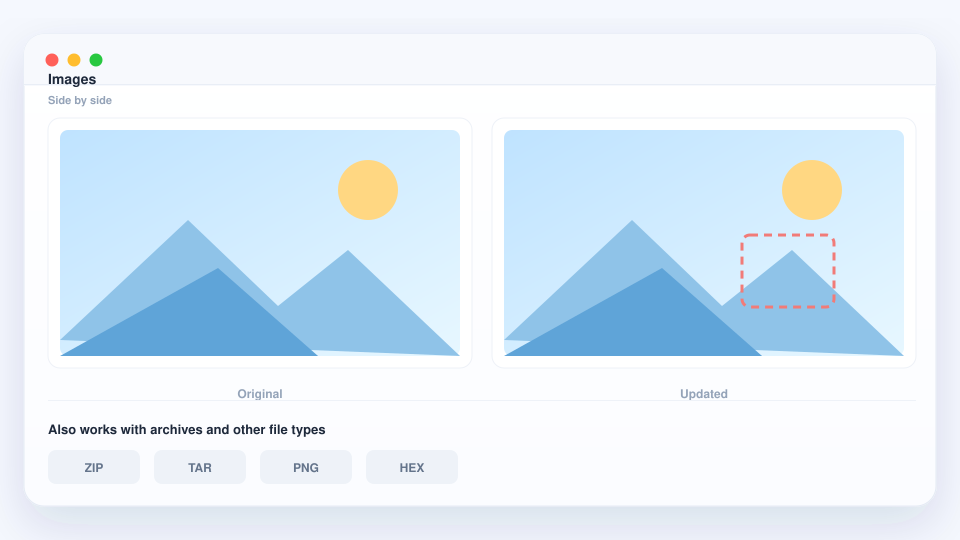

# 更多比较方式

文字只是其中一半。qDiff 用同样的「并排」思路，也能打开别的内容。

## 图片

把两张图并排放着慢慢看，或者叠在一起，直接看出哪里不一样 —— 设计改版、
几乎一模一样的照片，都很合适。

## 压缩包

.zip / .tar 可以直接打开，像文件夹一样比。不用解压，也不用事后清理临时文件。

## 不是纯文本的文件

两个文件看起来一样、用起来却不同时，qDiff 还能细到最小的差别，把普通文字
视图看不出来的变化也找出来。

## 把一次比较存成图片

选中一处改动，导出成一张干净的双栏图片，直接贴进聊天、文档或评审里。
导出的图片不会加任何标记。

## 按你的习惯来

- **外观** —— 浅色与深色，可以跟随 Mac，也可以自己指定。
- **语言** —— 简体中文、繁体中文、英文等多种界面语言。
- **字体与快捷键** —— 读着舒服，常用的操作也能用键盘完成。
- **最近比较** —— 昨天看过的内容，在欢迎页一点就回来。

以上全部包含在免费版里。

还有疑问？[看看常见问题](./faq.md)。
