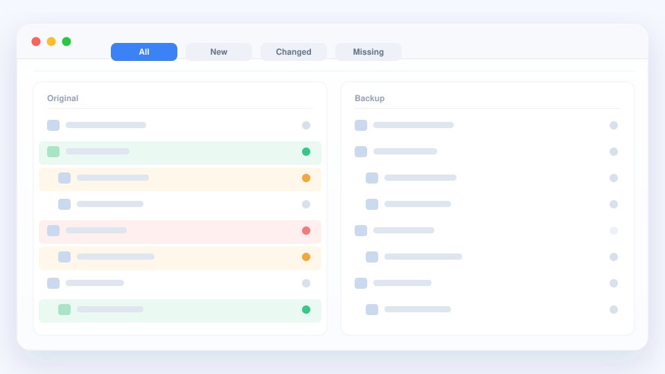

# 比較資料夾

兩個本該一致的資料夾 —— 工作副本和備份、舊匯出和新匯出 —— 逐個檔案去對，
實在太累。qDiff 把整棵樹一次擺出來。

## 打開兩個資料夾

把兩個資料夾拖進視窗，或者從「檔案 → 開啟」裡選。裡面的子資料夾也會一起比，
看到的是完整全貌。

## 一眼讀懂這棵樹

- **綠色** —— 只有一邊有這個檔案。
- **橙色** —— 名字一樣，內容不一樣。
- **紅色** —— 另一邊少了這個檔案。
- **灰色** —— 兩邊一致。

## 只看想看的

用狀態篩選把已經一致的檔案藏起來，也可以輸入名稱的一部分來縮小範圍。
可以只核對檔名，也可以連內容一起核對 —— 備份看起來齊全、裡面卻是舊內容時，
特別有用。

資料夾再大也能很快出結果，不用盯著進度條等。

## 在列表裡順手整理

把檔案複製到另一邊、刪掉多餘的、或讓一組檔案同步一致，都在這棵樹裡完成，
不用切回 Finder。

::: tip 放心先看看
在你主動選擇某個操作之前，磁碟上的內容不會有任何改動。單純瀏覽、篩選比較
是完全安全的。
:::

接下來：[提交前把專案看一遍](./projects.md)。
