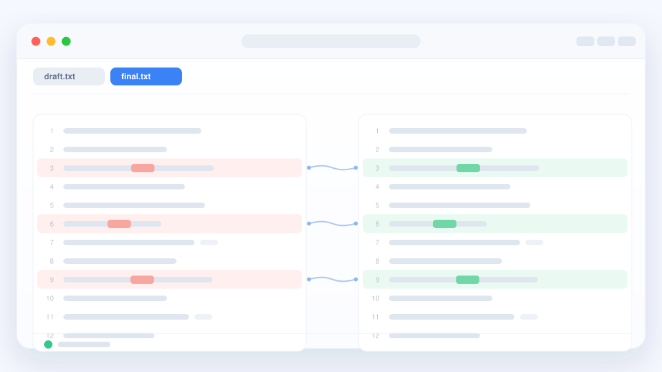

# 認識 qDiff

qDiff 只回答一個問題：**到底改了哪裡？** 把兩個版本並排放好，不同的地方
會用顏色標出來，不用再靠眼睛一行一行對。

## 大家最常拿來做的三件事

- **比兩份檔案** —— 初稿與改後稿、改前改後的設定、兩次匯出的內容。一行裡
  改動的那幾個字也會單獨標出來。
- **比兩個資料夾** —— 工作目錄和它的備份。多了什麼、改了什麼、少了什麼，
  一眼就能挑出來，還能順手讓兩邊一致。
- **看一個專案資料夾** —— 改動過的檔案排成一列，逐個看差異、提交，不用
  在幾個視窗之間來回切。

圖片、壓縮檔，以及不是純文字的檔案也能比，[看看還有哪些用法](./more.md)。

## 三步開始

1. 打開 qDiff，把兩個檔案或資料夾拖到視窗裡；也可以從「檔案」選單選擇。
2. 看帶顏色的行。點側邊的小地圖，或者用「上一處 / 下一處」按鈕逐個查看。
3. 需要調整就直接改、複製、同步；要給別人看，就把這次比較存成一張圖。

::: tip 不用先設定
不用註冊帳號，第一次比較之前也沒有什麼要設定的，離線就能用。
:::

## 免費，也安心

所有比較功能都免費。免費版只在標籤列上多一個小標記，一次性購買即可去掉。
qDiff 只讀取你選擇的檔案，不會把內容發出去，詳見[隱私政策](../privacy/)。

## 需要幫忙？

[常見問題](./faq.md)裡收了最常被問到的幾件事。如果還有問題，
[寫信給我們](./support.md)就好。
